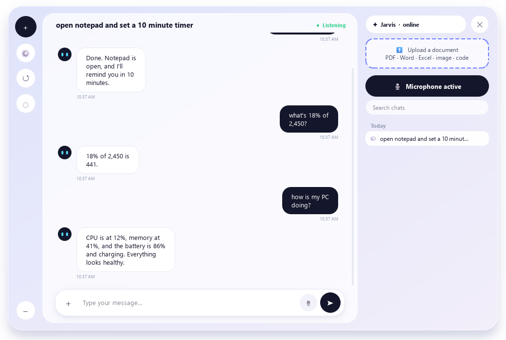
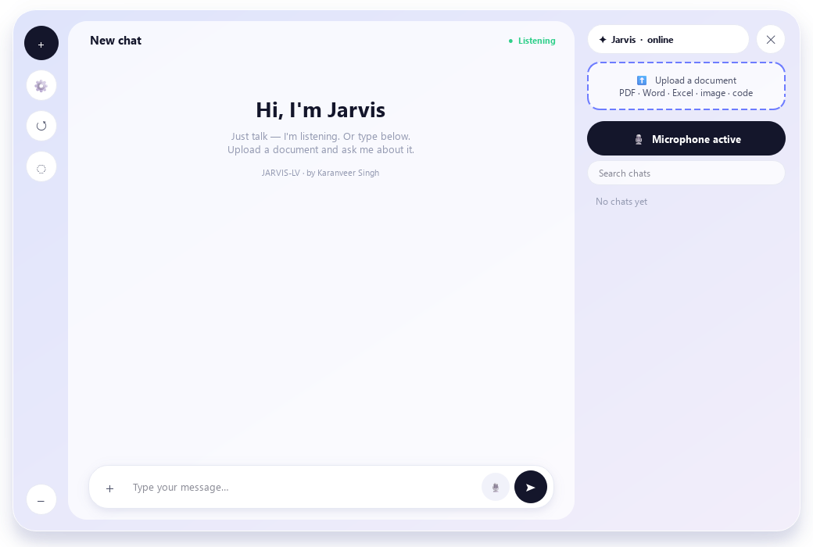
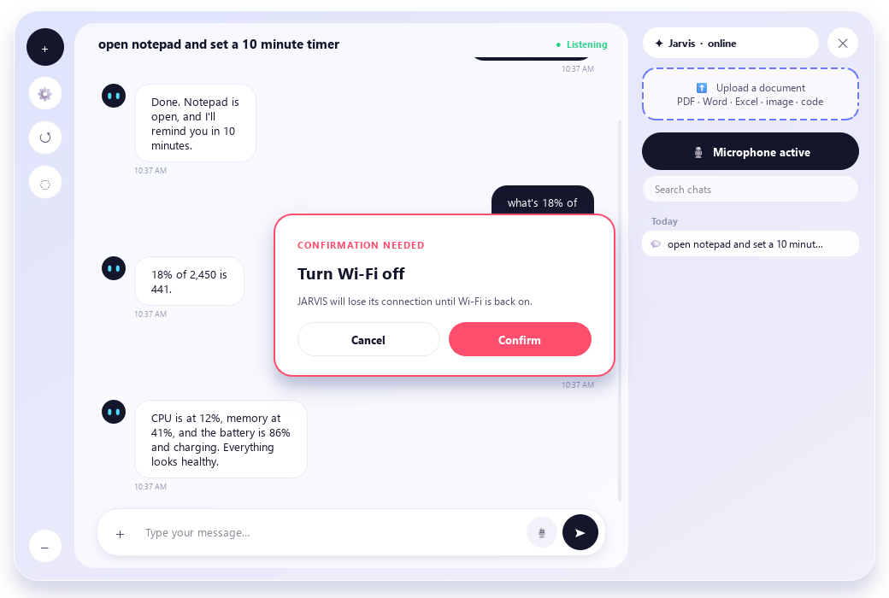

# 🤖 JARVIS-LV

### A voice AI assistant that hears, sees, speaks and controls your computer, and keeps working offline.

**Created by [Karanveer Singh](https://github.com/Karanveer05)**

[](https://creativecommons.org/licenses/by-nc/4.0/)


> ⚠️ **Using or sharing this project? You must credit the author.** See [Credit & License](#-credit--license).

<p align="center">
  
</p>

---

## 📖 Table of Contents

- [About](#-about)
- [Screenshots](#-screenshots)
- [What JARVIS-LV Adds](#-what-jarvis-lv-adds)
- [Features](#-features)
- [Quick Start](#-quick-start)
- [Portable Installer](#-portable-installer-windows)
- [Requirements](#-requirements)
- [Project Structure](#️-project-structure)
- [Running the Tests](#-running-the-tests)
- [Your Data & Privacy](#-your-data--privacy)
- [Credit & License](#-credit--license)
- [Author](#-author)

---

## 💡 About

JARVIS-LV is a real-time voice assistant for your desktop. It is built on the Gemini Live API for streaming audio. Talk to it or type, and it opens apps, manages files, searches the web, plays videos, sets timers, takes notes and answers questions.

I built JARVIS-LV as my own project on top of an open-source voice assistant base. My biggest additions are an **offline mode**, so the assistant still works with no internet; a new **floating robot chat interface**; and **21 more tools**.

📄 The full project documentation is in [`JARVIS-LV_Documentation_updated.pdf`](JARVIS-LV_Documentation_updated.pdf).

---

## 📸 Screenshots

<table>
  <tr>
    <td align="center" width="50%"><br><b>Welcome screen</b><br><sub>Talk, type or upload a document</sub></td>
    <td align="center" width="50%"><br><b>Real confirmation</b><br><sub>Risky actions wait for your click</sub></td>
  </tr>
  <tr>
    <td align="center"><br><b>Floating robot: listening</b></td>
    <td align="center"><br><b>Floating robot: speaking</b><br><sub>Click it to open the chat</sub></td>
  </tr>
</table>

---

## 🛠️ What JARVIS-LV Adds

| Addition | What it does |
|---|---|
| 📴 **Offline assistant** | With no internet, or when every Gemini model is rate-limited, a rule-based assistant takes over. It can open and close apps, tell the time, run timers, take notes, do maths, change volume and brightness, take screenshots, report battery, CPU and disk, and answer from your saved history. Speech uses Whisper (if cached) or the Vosk model in `models/vosk`. Windows only. |
| 🤖 **Floating robot + chat window** | The default interface (`ui_chat.py`). Click the robot to chat. **✕** closes JARVIS and **–** hides it back to the robot. To use the old HUD, set `"ui_mode": "classic"` in `config/api_keys.json`. |
| 🧰 **21 extra tools** | calculator, notes, timer, shell_command, process_manager, system_toggles, spotify, powerpoint, image_generate, logins (encrypted vault), clipboard_history, file_tools, network_tools, screenshot, daily_briefing, everyday, site_to_file, personality, lessons, routines, tool_builder. That makes **46 tools** in total. |
| 🧠 **Self-improvement switches** | It can remember facts, learn from corrections, notice routines, build new tools and install approved packages. Everything except "remember facts" is **off by default**. |
| ✅ **Real confirmation** | Shutdown, restart, Wi-Fi off, stopping programs, non-read-only shell commands, quitting and package installs all wait for a button that only you can press. |
| 👋 **English start-up greeting** | The launch greeting is always in English. After that it replies in the language you speak. |
| 📦 **Portable installer** | `JARVIS-Setup.exe` is a single file that installs JARVIS on another Windows PC without copying any of your personal data. |

---

## ✨ Features

These core features come from the base project, and all of them still work in JARVIS-LV.

| | Feature | Description |
|---|---|---|
| 🎙️ | **Real-time voice** | Low-latency conversation in any language over the Gemini Live API |
| 🗣️ | **Wake word & push-to-talk** | Local "Hey Jarvis" detection, or hold **Ctrl+Space** to talk |
| 🧑‍🎤 | **Holographic avatar** | An animated head with lip-sync, rendered in software (no GPU needed) |
| 🖥️ | **System control** | Launch apps, change volume, brightness and Wi-Fi, use shortcuts and power options |
| 👁️ | **Visual awareness** | Shares your screen and webcam with Gemini |
| 📺 | **Video on the HUD** | Plays YouTube, local files or video URLs inside the interface |
| 🔍 | **Web search** | News, research, prices and comparisons, using Gemini grounding with a DuckDuckGo fallback |
| 🧠 | **Persistent memory** | Remembers your projects and preferences across sessions, with a panel to view and delete facts |
| ↩️ | **Undo** | Reverses its own file moves, renames, writes and setting changes |
| 🪜 | **Model ladder** | Nine Gemini models in order of measured speed. If one fails, the next one takes over |
| 🧩 | **Plugins** | Drop one `.py` file into `plugins/` and JARVIS has a new skill |
| ⏰ | **Reminders & monitoring** | OS-native reminders, hardware telemetry, weather, topic watching |
| 📨 | **Messaging & browser** | Send messages and control the browser by voice |
| 🎨 | **Customisation** | Change the assistant's name, your name, the voice and the colour live from the UI |
---

## ⚡ Quick Start

```bash
git clone https://github.com/Karanveer05/JARVIS-LV.git
cd JARVIS-LV
python setup.py        # installs the dependencies for your OS and the browser engine
python main.py
```

1. Get a free Gemini API key from [Google AI Studio](https://aistudio.google.com/app/apikey).
2. Paste it in on the first launch. It is saved to `config/api_keys.json`.
3. Click the robot, or say **"Hey Jarvis"**, and start talking.

`setup.py` installs only what your operating system needs and checks your Python version first. You can also run `pip install -r requirements.txt` yourself.

> **Tip:** If you get `ModuleNotFoundError` for an OS-specific package, run `pip install <module_name>`. The optional wake-word engine is installed from **⚙ → WAKE WORD** inside the app.

---

## 📦 Portable Installer (Windows)

Build the installer once on your PC:

```bash
python portable/build_installer.py       # writes dist/JARVIS-Setup.exe (about 41 MB)
```

Copy `JARVIS-Setup.exe` to the other PC and double-click it. Windows SmartScreen may say "unknown publisher" because the file is not code-signed. Choose **More info → Run anyway**. The installer:

1. copies the program to `%LOCALAPPDATA%\JARVIS` (no administrator rights needed),
2. finds Python 3.11–3.13, or installs 3.12 with winget,
3. creates a private virtual environment and installs the libraries (this needs internet and takes several minutes),
4. adds Desktop and Start-menu shortcuts and an **Uninstall JARVIS** entry,
5. asks the new user for their own Gemini API key on first launch.

**It never packs your personal data:** not your API key or settings, chats, facts, notes, lessons, routines, offline history, the login vault, WhatsApp or Google sessions, AI-built plugins, caches or git history. The build works from an allow-list. It refuses to run if a forbidden file slips in, and it searches every packed file for your API key and account name. The offline speech model is included, so offline mode works on the new PC.

If you run the installer on a PC that already has JARVIS, it updates the program and keeps that PC's saved key and chats.

> Only part of the full install has been tested so far: unpacking, the icon and the first-run screen. Try it on a spare PC before you rely on it.

---

## 📋 Requirements

| Requirement | Details |
|---|---|
| **OS** | Windows 10/11, macOS or Linux (offline mode is Windows only) |
| **Python** | 3.11, 3.12 or 3.13 |
| **Microphone & speakers** | Needed for voice |
| **API key** | Free Gemini API key |
| **GPU** | Not needed |
| **Offline speech** *(optional)* | Vosk model in `models/vosk`, or a cached Whisper model |

---

## 🗂️ Project Structure

```
JARVIS-LV/
├── main.py                 # Core loop: Gemini Live session, audio, tool dispatch
├── ui_chat.py              # Floating robot + chat window (default interface)   ★ JARVIS-LV
├── ui.py                   # Classic PyQt6 HUD: avatar, waveform, settings
├── open_close_apps.py      # Windows app opener/closer for offline mode           ★ JARVIS-LV
├── setup.py                # OS-aware dependency installer
├── actions/                # Built-in tools; each one declares a TOOL dict + handler
├── core/
│   ├── offline_*.py        # Offline assistant, skills, voice and history          ★ JARVIS-LV
│   ├── lessons.py          # Learning from corrections                             ★ JARVIS-LV
│   ├── routines.py         # Noticing routines                                     ★ JARVIS-LV
│   ├── gemini.py           # Model ladder, timeouts, cooldowns
│   ├── confirm.py          # Confirmation gate for irreversible actions
│   ├── avatar*.py          # Avatar renderer and head geometry
│   └── ...                 # Wake word, hotkey, undo, audio devices, plugin loader
├── memory/                 # Memory and config managers (your data stays git-ignored)
├── plugins/                # Drop-in skills; start from _template.py
├── portable/               # Portable installer build + install/uninstall scripts  ★ JARVIS-LV
├── assets/                 # Robot icons                                           ★ JARVIS-LV
├── tests/                  # Test suites                                           ★ JARVIS-LV
├── docs/images/            # README screenshots                                    ★ JARVIS-LV
├── LICENSE                 # CC BY-NC 4.0 + copyright and attribution terms
├── NOTICE                  # Who made what, and how to credit it
└── CITATION.cff            # Powers GitHub's "Cite this repository" button
```

★ marks parts added in JARVIS-LV. The full list is in [`NOTICE`](NOTICE).

---

## 🧪 Running the Tests

Each suite is a plain script. Run it from the project root:

```bash
python tests/test_tools.py           # tools (offline checks only)
python tests/test_tools.py --live    # tools, including network checks (weather, site fetch)
python tests/test_offline.py         # offline assistant
python tests/test_selfimprove.py     # self-improvement switches
python tests/test_ui_chat.py         # robot + chat window
```

---

## 🔒 Your Data & Privacy

Everything stays on your machine. There is no server, no telemetry and no account.

| What | Where | Notes |
|---|---|---|
| Gemini API key, plugin credentials | `config/api_keys.json` | **Stored as plain text.** Treat it like a password file. |
| What the assistant remembers | `memory/*.json` | Delete these files to make it forget. |
| Saved site logins | `config/vault.enc` | Encrypted |

All of these are in `.gitignore`, so they are never committed. If you ever push an API key to a public repository, revoke it at [aistudio.google.com](https://aistudio.google.com/app/apikey). Deleting it in a later commit does not remove it from the git history.

While a session is open, your voice is streamed to Google's Gemini Live API. Nothing else leaves your computer. In offline mode, nothing leaves your computer at all.

---

## 📜 Credit & License

**Copyright © 2026 Karanveer Singh**

This project is licensed under **[Creative Commons Attribution-NonCommercial 4.0 (CC BY-NC 4.0)](https://creativecommons.org/licenses/by-nc/4.0/)**.

| ✅ You may | ❌ You may not |
|---|---|
| Use it for personal, study or non-commercial projects | Sell it or use it for any commercial purpose |
| Fork it, change it and share it | Remove or hide the credits and copyright notices |
| Show it in videos, reports and demos | Present it as your own work |
| | Let any company, organisation or institution claim it as theirs |

### ✍️ Credit is required

If you share, fork, redistribute, demo or build on this project, put this credit where people will see it, for example in your README, About screen, video description or report:

```
JARVIS-LV by Karanveer Singh (https://github.com/Karanveer05/JARVIS-LV).
Licensed under CC BY-NC 4.0.
```

Keep the [`LICENSE`](LICENSE) and [`NOTICE`](NOTICE) files in your copy, and say what you changed.

<sub>JARVIS-LV includes code from Mark LV by FatihMakes, used under CC BY-NC 4.0. Full notices are in [`LICENSE`](LICENSE) and [`NOTICE`](NOTICE).</sub>

---

## 👤 Author

**Karanveer Singh**: creator of JARVIS-LV

[](https://github.com/Karanveer05)

⭐ **If you find this project useful, please star the repository!**
